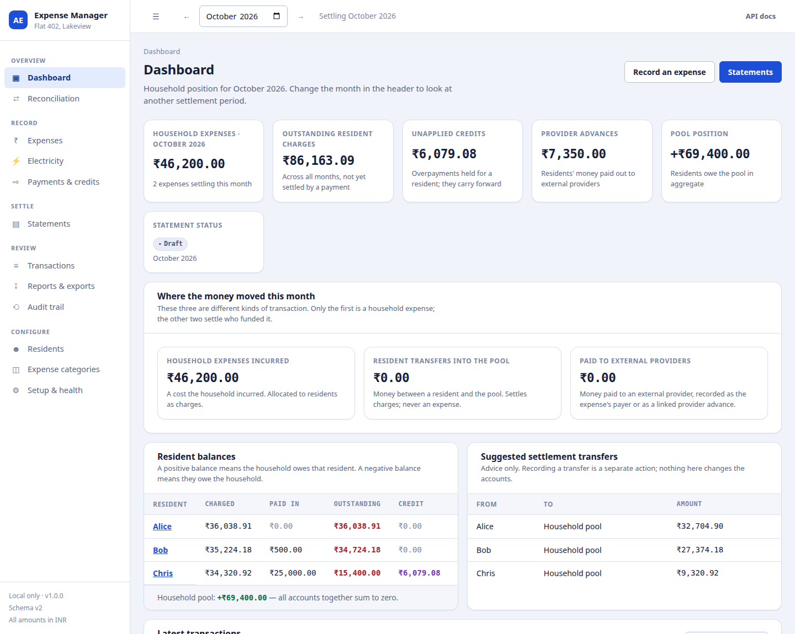
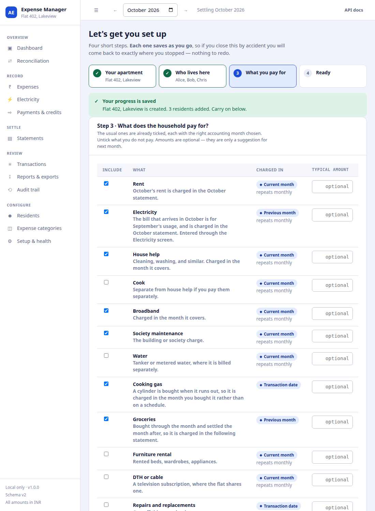
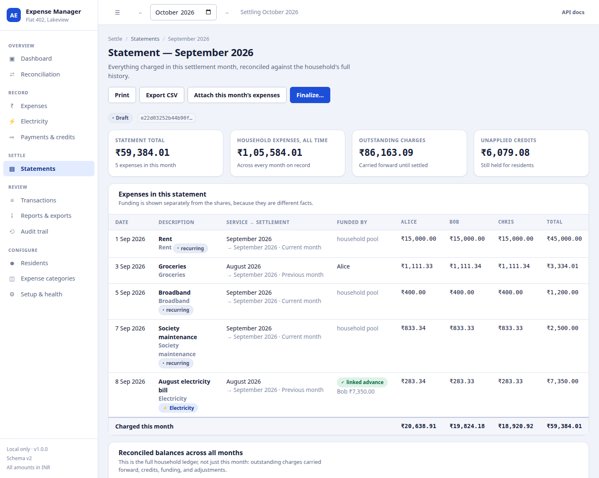
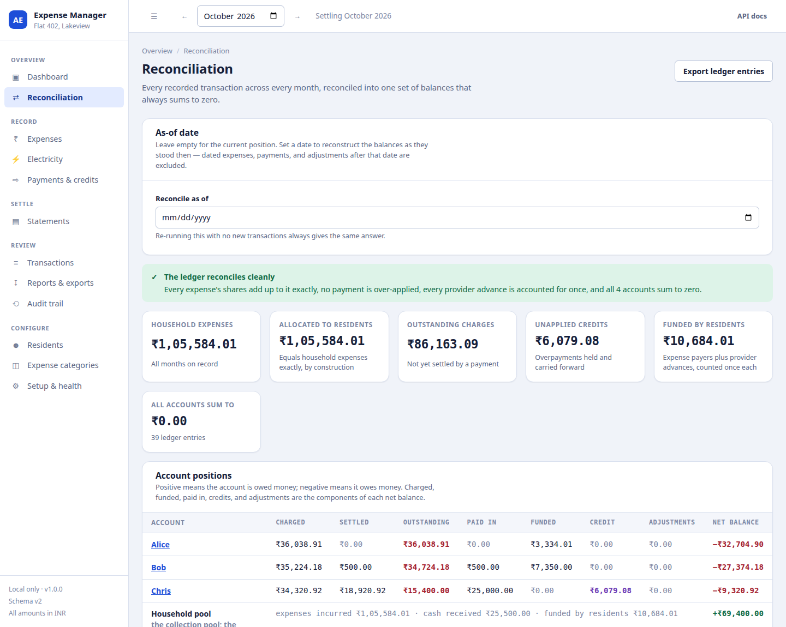

# Apartment Expense Manager

Household expense accounting for a shared apartment, running entirely on your
own machine. It records what the household spent, works out each resident's
share, tracks who actually paid, carries unpaid balances and credits forward,
and produces monthly statements that can be finalized, corrected within a
window, and then closed.

- **Backend** — Python + FastAPI over SQLite, with versioned migrations.
- **Frontend** — React + TypeScript + Vite.
- **Money** — integer paise everywhere. No floating-point arithmetic touches a
  financial value, from the input box to the database column.
- **Local-first** — one SQLite file, no cloud service, no account, no network
  dependency. It binds to `127.0.0.1` by default and has no authentication, so
  do not expose it (see [Security](#security)).



---

## Quick start

```bash
# 1. Backend dependencies (Python 3.10+)
python3 -m venv .venv
.venv/bin/pip install -e '.[dev]'

# 2. Frontend (Node 18+)
cd frontend && npm install && npm run build && cd ..

# 3. Create the database and start
./scripts/run.sh
```

Then open **http://127.0.0.1:8787**. A brand-new database takes you straight
into the guided setup; the API documentation is at `/docs`.

> If `python3 -m venv` fails with an `ensurepip` error on Debian or Ubuntu,
> install `python3-venv` first, or install the dependencies another way:
> `pip3 install --user fastapi 'uvicorn[standard]' pydantic pytest httpx` and
> run the scripts with `PYTHON=python3 ./scripts/run.sh`.

To look around before entering real data:

```bash
.venv/bin/python scripts/manage.py demo    # a sample household, two months
```

### Development

```bash
./scripts/dev.sh      # API with reload on :8787, Vite dev server on :5173
```

Open the Vite URL; it proxies `/api` and `/health` to the backend.

---

## What it does

### Guided setup

Opening a new database drops you into a four-step setup rather than an empty
dashboard: name the place, list who lives there, tick what the household pays
for, done. Identifiers are derived from the names you type, the usual
essentials come pre-ticked with the right accounting month already chosen, and
amounts are optional.

**Closing it halfway costs nothing.** Every step commits when you press
Continue, and the step to resume at is read back from the server — from
whether an apartment row, resident rows, and definition rows actually exist.
Close the tab, clear the browser, move to another machine: you come back
exactly where you stopped. If you navigate away mid-setup, a banner offers to
pick it up again.



### Dashboard

Current balances, this month's household expenses, what each resident paid,
outstanding charges, unapplied credits, provider advances, the latest
transactions, and the statement's status. Every figure comes from the
reconciliation of real records — there are no placeholder numbers anywhere in
the application. If the data cannot be reconciled, the dashboard says so
instead of showing a figure that looks fine.

### Residents

Create and edit residents, record move-in and move-out dates, and see each
resident's charges, payments, credits, and history. A resident is never
deleted: moving somebody out marks them inactive and keeps every record.

### Expense categories

Rent, electricity, house help, broadband, society maintenance, cooking gas,
groceries, furniture rental — none of these is built into the application.
They are rows you create, rename, re-rule, and retire. Each one carries a
**period rule** and defaults for amount, allocation method, participants, and
recurrence.

The guided setup offers a catalogue of twelve common ones as a starting point,
but they are only suggestions: each becomes an ordinary editable record, and
you can add your own in the same step.

### General expenses

Record an expense with its description, category, amount, transaction date,
accounting periods, payer, provider, reference, and notes. Allocate it by equal
shares, weighted shares, or exact custom amounts; the breakdown is calculated
by the same engine that will save it and shown before anything is written. The
shares must total the expense exactly, and everything is written in one
transaction.

### Electricity

A dedicated module over the standalone electricity engine. The actual utility
bill and its itemised charges are authoritative; smart-plug readings are
allocation weights you supply. Each charge can use its own rule, so energy can
follow measured usage while fixed and common-area charges split equally or by
an agreed exception. You review the full calculation before committing it.

### Housing & Utilities

One hub (`/services`) for the household's recurring services. Rent and
electricity are live, each with a card summarising the selected settlement
month and a link to its own screen; water, cooking gas, broadband and house
help are shown as planned. The rent and electricity screens live under it at
`/services/rent`, `/services/rent/config` and `/services/electricity`.

### Rent management

A dedicated module for single master lease rent. Configures landlord details,
statutory PAN, and total contract rent. Splits rent equally among active
residents on the 1st of each month. Features **targeted rent payments** so money
paid for rent settles that month's rent allocation first, **deferred/optional
landlord receipt attachments**, and one-click printable **HRA rent receipts**
(Section 10(13A) IT Act compliant).

The lease also carries its **contract term**: start date, duration, notice
period, lock-in, security deposit and an escalation clause (a percentage, a
fixed renewal rent, or none). The Rent screen shows where the term stands, and
when the notice window opens it asks the household to choose between
**renewing** — which archives the finished term and starts the next at the
escalated rent — and **serving notice to vacate**. A term that has run out
never blocks a month's rent from being generated.



### Payments and credits

Payments into the pool (applied to the oldest open charges first), payments to
external providers, refunds, and signed ledger adjustments. Overpayments stay
visible as unapplied credits and carry forward. Corrections are auditable
reversals, never edits.

### Statements

Create a draft for a settlement month, collect its expenses by their period
rules, generate recurring ones, review, finalize into a hashed snapshot,
correct within a 72-hour window through numbered revisions, then close — after
which the snapshot is immutable and corrections become ledger adjustments.

### Reconciliation, transactions, reports

One auditable calculation across every month, with the ledger entries behind
each figure; a searchable transaction ledger; an append-only audit trail; and
ten reports, all exportable as CSV, plus a printable statement view.

---

## The accounting model in one page

Every expense is **three separate facts**, and keeping them apart is what stops
the same rupee being counted twice:

1. **The household incurred a cost.** One `expense_instance` row.
2. **Each resident owes a share of it.** `allocation` rows that must sum to the
   expense amount exactly.
3. **Somebody funded it.** Either the expense's `payer_resident_id`, or a
   `provider_advance` payment linked to the expense. Funding is not a second
   expense.

Accounts and signs:

|                   | Meaning                                                               |
| ----------------- | --------------------------------------------------------------------- |
| Positive position | This account is **owed** money                                        |
| Negative position | This account **owes** money                                           |
| `__pool__`        | The collection pool. Positive means residents owe the pool in aggregate. |

All accounts — every resident plus the pool — always sum to **zero**. The
calculation asserts it, and refuses to report settlement figures rather than
invent a balancing entry.

### The rule that prevents the common double count

If **any** provider advance is linked to an expense, the linked advances are the
funding record and that expense's `payer_resident_id` is **ignored**. Only when
no advance is linked does the payer field act as the funding record. An unlinked
advance that matches an expense's payer, amount, and date is flagged by name as
a likely duplicate.

### Period rules

Two periods are tracked per expense, because conflating them is the other
common source of error:

- **Service period** — the month the money was *for*.
- **Settlement period** — the statement month that *charges* it.

| Rule               | Service period               | Settlement period          | Suits                                               |
| ------------------ | ---------------------------- | -------------------------- | --------------------------------------------------- |
| `current_month`    | month of the transaction     | month of the transaction   | rent, broadband, maintenance, furniture rental       |
| `previous_month`   | month before the transaction | month of the transaction   | electricity, groceries                               |
| `transaction_date` | month of the transaction     | month of the transaction   | one-off purchases, repairs                           |
| `custom`           | you choose                   | you choose (required)      | anything the rules misstate                          |

So the September electricity bill paid in early October has a **September
service period** and is charged in the **October statement**, and consumption
reports stay truthful. Both periods can be overridden per expense.

### Rounding

Equal splits assign the base share first, then distribute remainder paise to
**non-payers before the payer**, in resident-ID order, so the payer is never the
one charged the spare paisa. Weighted and measured splits use the largest-remainder method
with the payer placed last in the tie-break. Every split totals the amount
exactly, and the result is deterministic.

Full detail: [`docs/ACCOUNTING_RULES.md`](docs/ACCOUNTING_RULES.md).



---

## Commands

```bash
.venv/bin/python scripts/manage.py init            # create or upgrade the database
.venv/bin/python scripts/manage.py status          # schema version and record counts
.venv/bin/python scripts/manage.py serve           # run the API and the built UI
.venv/bin/python scripts/manage.py check           # accounting validation + reconciliation
.venv/bin/python scripts/manage.py backup          # safe copy into ./backups
.venv/bin/python scripts/manage.py restore <file>  # restore a backup
.venv/bin/python scripts/manage.py close-expired   # close statements past their window
.venv/bin/python scripts/manage.py demo            # load a sample household
```

Sample data for the rent and lease screens, on top of the `demo` household:

```bash
.venv/bin/python scripts/seed_lease_data.py --replace-existing-rent   # a lease in its second term, October rent part-collected
.venv/bin/python scripts/seed_lease_data.py --scenario final-month --replace-existing-rent   # the same, in the term's last month
.venv/bin/python scripts/seed_settlement_periods.py                   # three months that each look different on the hub
```

The original terminal workflow still works against the same database:

```bash
.venv/bin/python legacy/apartment_setup_cli.py   --db data/apartment.sqlite
.venv/bin/python legacy/electricity_entry_cli.py --db data/apartment.sqlite --apartment home
.venv/bin/python legacy/ledger_entry_cli.py      --db data/apartment.sqlite --apartment home
```

---

## Tests

```bash
.venv/bin/python -m pytest        # 488 backend tests
cd frontend && npm test           # 121 frontend tests
```

The backend suite includes the original prototype's 53 `unittest` tests under
`legacy/`, which pytest collects and which run against the refactored services
unchanged.

---

## Backing up and restoring

The whole database is one SQLite file (`data/apartment.sqlite` by default).

```bash
.venv/bin/python scripts/manage.py backup
```

This uses SQLite's own backup API, so it is safe while the application is
running, and it verifies the copy's integrity before reporting success.
Backups land in `./backups/apartment-<timestamp>.sqlite`. **Keep a copy
somewhere other than this directory too.**

```bash
.venv/bin/python scripts/manage.py restore backups/apartment-20261011T013036.sqlite
```

Restoring verifies the backup first, moves any existing database aside rather
than deleting it, and runs migrations on the restored file. Full procedure:
[`docs/OPERATIONS.md`](docs/OPERATIONS.md).

---

## Security

This is a **single-operator, local-first** application with **no
authentication**, and none is implied. Anyone who can reach the HTTP port can
read and change the household's accounts. The defaults keep that to your own
machine:

- the server binds `127.0.0.1`; it warns loudly if configured otherwise;
- CORS allows only the local Vite dev origins;
- the database is an ordinary file with ordinary file permissions;
- the frontend can only call the documented API — no endpoint accepts SQL, and
  no endpoint exposes the filesystem.

Do not expose this to the internet, and do not put it behind a reverse proxy
without adding authentication first.

---

## Configuration

Every setting is an `AEM_`-prefixed environment variable.

| Variable                      | Default                   | Meaning                                              |
| ----------------------------- | ------------------------- | ---------------------------------------------------- |
| `AEM_DB_PATH`                 | `./data/apartment.sqlite` | SQLite file                                          |
| `AEM_HOST`                    | `127.0.0.1`               | Bind address. Anything else is a network exposure.   |
| `AEM_PORT`                    | `8787`                    | Port                                                 |
| `AEM_AUTO_MIGRATE`            | `true`                    | Run pending migrations at startup                    |
| `AEM_AUTO_CLOSE_EXPIRED`      | `true`                    | Close statements whose window elapsed while stopped  |
| `AEM_AUTO_CLOSE_INTERVAL_MINUTES` | `60`                  | How often a running app closes expired statements; `0` turns the loop off |
| `AEM_TAPO_USERNAME`           | unset                     | TP-Link account for the optional Tapo connector      |
| `AEM_TAPO_PASSWORD`           | unset                     | Read from the environment only; never stored or returned |
| `AEM_TAPO_PLUGS`              | unset                     | `alice=192.168.1.21:Room 1 AC,bob=192.168.1.22`      |
| `AEM_CORRECTION_WINDOW_HOURS` | `72`                      | Default correction window                            |
| `AEM_OPERATOR_NAME`           | `operator`                | Recorded as the actor in the audit trail             |
| `AEM_CORS_ORIGINS`            | the Vite dev origins      | Comma-separated                                      |
| `AEM_LOG_LEVEL`               | `INFO`                    | Python log level                                     |

---

## Documentation

| Document                                                 | Contents                                                |
| -------------------------------------------------------- | ------------------------------------------------------- |
| [`docs/ARCHITECTURE.md`](docs/ARCHITECTURE.md)           | How the pieces fit together, and why                    |
| [`docs/DATA_MODEL.md`](docs/DATA_MODEL.md)               | Every table and column                                  |
| [`docs/ACCOUNTING_RULES.md`](docs/ACCOUNTING_RULES.md)   | The rules, the invariants, and the decisions still open  |
| [`docs/USER_GUIDE.md`](docs/USER_GUIDE.md)               | How to run a month, end to end                          |
| [`docs/OPERATIONS.md`](docs/OPERATIONS.md)               | Migrations, backup, restore, troubleshooting            |
| [`docs/SPECIFICATION.md`](docs/SPECIFICATION.md)         | The business specification                              |
| [`docs/CHECKLIST.md`](docs/CHECKLIST.md)                 | What was found in the repository and what was built     |
| [`docs/KNOWN_LIMITATIONS.md`](docs/KNOWN_LIMITATIONS.md) | What this does not do, stated plainly                   |
| [`docs/TEST_RESULTS.txt`](docs/TEST_RESULTS.txt)         | The recorded test run                                   |
| [`docs/handoffs/`](docs/handoffs/)                       | The design briefs individual features were built from   |

---

## Repository layout

```
aem/                        the Python package
  engine/                   pure accounting engines (no I/O, no side effects)
  services/                 business logic, one module per area
  api/routers/              HTTP routing only
  schemas/                  typed request and response models
  migrations/               versioned, forward-only SQL
frontend/src/               React + TypeScript
  pages/                    one file per screen
  pages/services/           the Housing & Utilities hub, rent, lease, electricity
  components/ lib/ api/     shared UI, formatting and helpers, the API client
tests/                      pytest: invariants, API, migrations, rent, end-to-end
scripts/                    manage.py, run.sh, dev.sh, and the sample-data seeds
docs/                       architecture, data model, rules, guide, operations,
                            specification, checklist, limitations
docs/handoffs/              feature design briefs
legacy/                     the original prototype's CLIs, tests, schema.sql, and
                            compatibility modules re-exporting aem.*
data/  backups/             the SQLite database and its backups (not committed)
```
